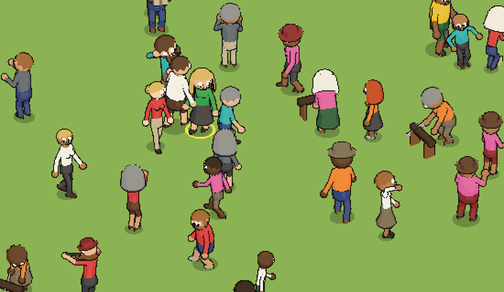
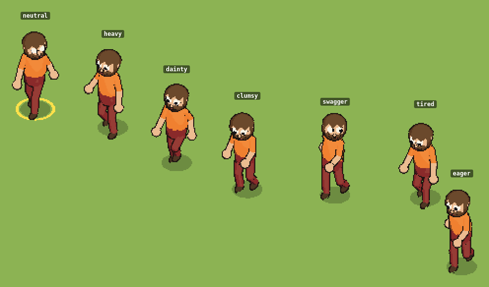

# Mini People

Tiny generative people that walk, work, chat, fiddle and dance in the browser.

**▶ [The demo](https://gromgull.github.io/mini-people/demo.html)** · [the village (in progress)](https://gromgull.github.io/mini-people/)

There are two apps on the same code. The **demo** (`demo.html`) is the
playground: crowds in different modes, every action on a key, and a GUI for
all the knobs. The **village** (`index.html`) is where this is heading: a
little settlement whose people do jobs that feed each other, such as chopping
trees, carrying logs and sawing them, with real objects instead of conjured
ones.



## Why

Lemmings, Cannon Fodder, Sensible Soccer and The Settlers had characters only
a handful of pixels tall, yet they felt alive. That came almost entirely from
*how they moved*. This project asks how far you can push that idea when
everything is procedural:

- **Procedural people.** Every person is grown from a small genome (height,
  build, head size, nose, hair style, beard, clothes, colours, …) and built from
  primitive meshes at runtime. There are no sprites and no models.
- **Procedural animation.** Nothing is keyframed. Walking, waving, hammering,
  sawing, sitting, falling and dancing are computed every frame on one shared
  rig. The gait comes from stride, duty cycle, bounce, sway, hip roll and arm
  swing, and actions are layered on top with springs, inverse kinematics
  (planar and two-bone) and a small ragdoll for falls.
- **Personality encoded in motion.** Each person also carries a *persona*,
  six sliders: `weight`, `energy`, `dainty`, `posture`, `swagger` and `sloppy`.
  These don't select animations. They bend the same procedural motion: a heavy
  person plants their feet and rolls their shoulders, an energetic one bounces,
  a sloppy one flops their arms. The persona can be set by hand, picked from
  presets, or derived from the body. The hope is that you can tell people
  apart in a crowd of 100 by their walk alone, the way you recognise a friend
  across a street before you can see their face.



*Compare mode: one body, seven personalities (neutral, heavy, dainty, clumsy,
swagger, tired, eager).*

The same approach carries over to sound. Everything is synthesised with Web
Audio from the same genome, with no samples:

- **Footsteps** are heavier for heavier people.
- **Voices** are gibberish whose pitch and vowel character follow body size.
- **Tools and props** have their own sounds: hammer, saw and box.
- **Fiddle tunes** are generated in G, in AABB form over chord progressions.
  Several fiddlers split into melody, harmony and bass parts that play in
  time together. Banjos play strict old-time bum-ditty under them: the
  melody note, a brush down across the chord, and the open G of the short
  fifth string. A double bass plays the chord's root and the fifth below it
  on the beat.

## What's in it

- **Modes**
  - *parade*: a marching ring.
  - *wander*: a free-roaming square where people walk around each other and
    start doing things.
  - *stand*: a grid.
  - *compare*: persona lanes.
  - *single*: one person up close. With *walk* on, they stroll a loop while
    acting.
- **Actions:** wave, hammer, jump, trip, carry a box, sit on a bench, talk
  (with turn-taking, nods and gestures), saw a log, fiddle, play the banjo or the double bass, smoke a pipe, dance, chop down a
  pine, pick an apple, and fish. Apples and fish are carried off afterwards.
  Sit down at a farmhouse table (shuffling the bench in) to eat an apple or a
  fish, or to drink from a tankard; asking for more while seated adds to the
  meal instead of getting up.
  Dancers and fiddlers share one beat.
  Props are conjured and fitted to the person: the trunk stands where *their*
  axe lands, the apple hangs where *their* hand reaches.
- **Faces:** googly eyes that look at each other, the camera, the cursor or
  whatever just happened, plus noses and beards. The mouth shows the mood,
  not a gene. It gasps at a fright and opens for a bite. It flaps while
  they talk and smiles (or smirks) between words. It frowns for a while
  after a fall or under a heavy log, and keeps a straight face at work, on
  the way somewhere or waiting at the table. At their ease (idle, sat,
  smoking, playing, dancing, fed) they smile.
- **Look:** cel shading through a palette atlas, pixelation, outlines, banded
  haze toward a horizon, a sky and drifting clouds. There's also an optional
  "animate on twos" low frame rate.
- **Village:** a pine forest, an apple glade, a pond, a two-storey
  half-timbered inn (chimney, a kitchen serving hatch, a sign over the door)
  and a few log cabins that vary in size, roof, windows and trim. Buildings
  cast their real silhouette as a shadow, following the sun.

## Controls

| | |
|---|---|
| click | select a person (also turns sound on) |
| shift + click | shove them |
| `1`–`9`, `0` | wave / hammer / jump / trip / carry / sit / talk / saw / fiddle / dance |
| `C` / `A` / `F` | chop a tree / pick an apple / fish |
| `T` / `E` / `D` | sit at a table / eat / drink |
| `H` / `B` / `G` | haul a log / play the banjo (tick "musicians sit down" to play seated) / carry an armful of firewood |
| `U` / `P` | play the double bass (always standing) / smoke a pipe |
| `S` | show / hide the fps overlay |
| `W` | toggle walking (single mode) |
| drag / scroll | orbit / zoom (orbit low to see the sky) |

The panel on the right has the rest: crowd size and seed, gait and persona
sliders for the selected person, looks, and sound levels.

### URL parameters

Handy for sharing a particular scene, e.g.
`?mode=single&who=3&walk` or `?mode=wander&count=80&seed=7`.

| Parameter | Effect |
|---|---|
| `mode` | `single` · `stand` · `parade` · `wander` · `compare` |
| `seed` | which crowd you get |
| `count` | how many people |
| `who` | which person single mode shows |
| `walk` | single mode starts walking |
| `spacing` | how spread out the crowd is |
| `speed` | walking speed |
| `persona` | how strongly personality shows (0 = none) |
| `auto` | random actions in parade / stand |
| `zoom` | camera zoom |
| `az` / `el` | camera angle |
| `px` | pixel size |
| `fps` | animate on twos (e.g. 10) |
| `maxfps` | render frame-rate cap (default 30; 0 = uncapped) |
| `stats` | start with the fps / frame time / draw call overlay on |
| `smooth=1` | smooth shading instead of bands |
| `outline=0` | no outlines |
| `time` | time of day in hours, 0–24 (default 10; 18 ≈ sunset, 0 = midnight) |
| `daycycle=0` | stop the clock (by default a day passes in `daymin` minutes) |
| `daymin` | real minutes per day when the clock runs (default 30) |
| `flowers` | flower density, 0–1 (0 = none) |
| `trees=0` | no forest or apple trees |
| `pond=0` | no pond |
| `houses=0` | no inn or cabins |
| `tx`, `tz` | point the camera somewhere other than the middle |
| `look` | where everyone looks: `auto` · `cursor` · `camera` · `selected` |
| `mute` | start silent |
| `nogui` | hide the panel |
| `paused` | start paused |
| `t` | simulate this many seconds before the first frame |

## The village

`index.html` is the start of a small settlement with a working economy.

The layout comes from the seed (`?seed=n`), along with the villagers.
Without one you get a village of your own: a random seed, put in the address
so a reload or a shared link keeps it. A woodyard sits in the middle, with
four districts around it: the forest with the lumberjack's cabin; the pond
with the fisher's cabin and bench; the inn with its tables, kegs,
street-lamp and the green where they dance; and the orchard with the cider
mill, the pickers' baskets and ladders and their cabins. Each seed shuffles
their order around the yard and gives each district its own direction,
distance and turn. Each district keeps its own arrangement, so everything
still works. The woodworker's cabin goes in the widest gap between
districts, the drying rack on the way from the pond to the inn, and a layout
where anything overlaps is thrown away and redrawn. Building looks, the
forest, the orchard and the pond's shape vary with the seed too.

So far it has one chain:

- **The lumberjack** keeps the woodpile topped up. When the pile, counting
  logs already on their way and logs lying in the forest, has fewer than
  four, they claim the nearest free pine and walk up to it side-on. They
  stand exactly where *their* axe meets the trunk, fell it (it leaves two
  logs and a stump), then carry each log to the pile on their shoulder.
- **The woodworker** carries logs from the pile to the sawhorse and saws
  each into four pieces of firewood. They
  gather the pieces in their arms and stack them in the yard.
- **Firewood to the inn:** the inn keeps a stack by its kitchen end and its
  fire burns a piece every so often. When it's below eight, the woodworker
  carries an armful over, before sawing more if the inn is nearly out.
  Delivery is a general job, "fetch n pieces from one stack to another", so
  later a porter or the innkeeper can take it.
- **The fisher** walks to the pond's shore (on the side toward the drying
  rack), casts into the real water and lands each fish on the grass beside
  them. After three they gather the catch in their arms and hang it on the
  rack, as long as it has room.
- **The drying rack:** fish hang by their tails over a pole in pairs, and
  over two minutes turn from silver to stockfish brown.
- **The innkeeper** keeps the larder crate by the kitchen hatch stocked with
  dried fish fetched from the rack, using the same delivery job as the
  firewood. Guests eat one every so often.
- **The apple pickers** (there are two, to keep the mill fed) each have
  their own basket and step-ladder. A picker fetches the basket (wherever it
  was left), carries it to a tree with ripe apples, sets it down and picks
  into it one apple at a time: they stand exactly where their stretch meets
  that apple, and the arm is solved onto it. The orchard's trees come in all
  sizes, and for an apple out of reach they carry the step-ladder over, set
  it down under the apple, step up, pick, and step down again. The ladder
  stays where it was left. With five apples they carry the basket to the
  cider mill and tip them into its hopper. Picked apples grow back.
- **The miller** turns the mill's crank once the hopper holds twelve apples;
  the apples go down one by one, and a keg of cider stands full under the
  spout, which they carry to the keg rack.
- **The innkeeper** also fetches kegs to the inn, cooks supper, and serves: when the
  regular's tankard is empty they draw a fresh one from a keg and bring it
  to the table.
- **The regular** has no job. They sit at the inn's table, sip cider every
  so often, and wait when the tankard's empty.
- **The day:** the village keeps its own clock on simulation time (a day is
  12 real minutes at ×1, `?daymin=` to change it; the evening runs at half
  speed). Work runs from 06:30. At 16:00 everyone finishes what they're doing
  and goes to the inn for supper. There are two tables and eight places. The
  innkeeper cooks dried fish from the larder at the kitchen hatch and brings
  the plates out one by one.
- **The street-lamp:** at dusk the innkeeper goes over to the lamp by the
  tables (between plates, if they're serving) and reaches up to light it.
  Its warm light really lights the tables, the diners and the green, in
  toon bands, and the lantern glows. They put it out on their way to bed.
- **The dance:** having eaten, people go out to the green in front of the
  inn. Those with an instrument stand in an arc with the tables behind them
  and play; the rest dance in the middle while there's music. While there
  isn't, they stand about chatting with whoever's free (a musician between
  tunes, too), with a pipe if they smoke. Once everyone's fed the innkeeper
  brings their fiddle too, and the whole band plays with hardly a pause
  between tunes. At 22:00 they finish the tune (or the dance), walk home
  and go in; their lamps glow for an hour and a half. Anyone supper didn't
  reach goes to bed hungry. At 06:30 they come out again.
- **One size of furniture:** benches, tables and the sawhorse are built for
  a villager of middling build, and everyone fits themselves to them. They
  sit down by however much their legs need for the real seat, reach for the
  real table top, and crouch to the real log, so a short woodworker saws
  standing tall and a tall one bends their knees.
- **Talk:** people chat over whatever else they're doing, with gestures of
  a free hand, nods and head-shakes, gibberish voices taking turns, and eyes
  on each other. Diners at a table talk in pairs while they wait for supper,
  the innkeeper has a word as each plate or tankard goes down, and two
  people meeting on their way now and then stop for a chat before going on.
- **Smoke** rises from the inn's chimney while its fire has firewood, and
  thinly from the cabins.
- **Spare time:** with nothing to do, people now and then sit on a free
  bench (their own first, if they have one), play their instrument or
  smoke a pipe. The woodworker and the pickers play the banjo, the
  lumberjack and the innkeeper the fiddle, and the miller the double bass
  (standing only). The lumberjack, the fisher and the miller smoke a pipe,
  standing or seated, with a wisp off the bowl and a breath of smoke after
  each draw. They
  stop, get up and go as soon as there's work. Everyone plays the same
  shared tune, so whoever's playing plays together.
- **Stumps grow back:** a sapling appears after about a minute and becomes a
  full tree over about two more.

Everything is a real object with a place. Trees and logs are claimed so
nobody goes for the same thing twice. The actions from the demo work on
the real things: the chop rebuilds exactly the tree that's standing there,
and the haul and the saw use the actual log.

| | |
|---|---|
| click | follow that person |
| space | pause |
| `F` | speed ×1 / ×4 / ×16 |
| `?seed=n` | which village (left out, you get a random one, written into the address so it stays yours) |
| `?follow=i`, `?speed=n`, `?logs=n`, `?wood=n`, `?innwood=n`, `?fish=n`, `?rackfish=n`, `?apples=n`, `?kegs=n` | follow someone, run faster, start with logs in the pile, firewood in the yard / at the inn, dried fish in the larder, fish on the rack, apples in the hopper, kegs at the inn |

The panel at the bottom left (hidden at first: tick "who's doing what" in
the menu, or `?panel=1`) shows who's doing what, the woodpile and the
tallies. `npm run test:village` runs the village headless for ten simulated
minutes and checks that every log stays in exactly one consistent place,
that only one tree is felled at a time, that nobody gets stuck, and that
work gets done.

## Running it

```sh
npm install
npm run dev        # http://localhost:5173 (village), /demo.html (demo)
npm run build      # type-check + production build into dist/
```

Pushing to `main` deploys to GitHub Pages
(`.github/workflows/pages.yml`).

The `scripts/` folder holds the headless test and inspection tools, driven by
Playwright with software WebGL. They need `npx playwright install chromium`
once.

- `npm run shot`: boots the demo, renders about 40 scenes into `screenshots/`,
  and fails on any console error. `Math.random` is seeded, so paused scenes
  come out identical run to run, which makes it a before/after check for
  refactors.
- `node scripts/sounds.mjs`: renders every sound recipe offline to WAV, plus a
  spectrogram sheet.
- `node scripts/tune-sheet.mjs`: prints generated fiddle tunes as chords and
  three parts, bar by bar.
- Other probes check gait, stance, trips and crowd overlaps.

## Code tour

| File | What it does |
|---|---|
| `src/genome.ts` | the random genome: shape genes, looks, persona |
| `src/body.ts` | builds a person's meshes and joint hierarchy from a genome |
| `src/skin.ts` | merges each person into one draw call (plus outline): parts stay in the tree for posing and picking, a vertex shader places them by rigid skinning |
| `src/persona.ts` | personality sliders, presets, and how they turn into gait style |
| `src/gait.ts`, `src/animate.ts` | the walk cycle and per-frame posing |
| `src/springs.ts`, `src/ik.ts`, `src/ragdoll.ts` | secondary motion, inverse kinematics, falling over |
| `src/actions.ts` | the action runner: each action's props and pose layers |
| `src/chores.ts` | chopping, apple picking and fishing, with their conjured trees, pool and catch |
| `src/dine.ts` | the table and benches, sitting down at them, eating and drinking (props lead, IK arms follow) |
| `src/actionkit.ts` | shared action helpers: pose types, easing, FK prop fitting |
| `src/gaze.ts` | eyes and head: who looks at whom |
| `src/wander.ts` | the roaming crowd: targets, steering, personal space |
| `src/tune.ts` | AABB tunes in G: fiddle melody, harmony and bass parts, the banjo's bum-ditty, the double bass |
| `src/audio.ts` | all sound synthesis |
| `src/trees.ts`, `src/pond.ts`, `src/houses.ts` | scenery: forest and glade, the pond, the inn and cabins (merged into a few draw calls) |
| `src/materials.ts`, `src/palette.ts`, `src/environment.ts` | toon shading, colours, haze, sky, clouds |
| `src/stage.ts` | shared by both apps: renderer, pixel target, camera, materials, sky, time of day, light, drop shadows, fps overlay, the capped main loop |
| `src/crowd.ts` | shared by both apps: spawning people and running them each frame (action, animation, gaze, sound, effects) |
| `src/demo.ts` | the demo: modes, GUI, input |
| `src/village/` | the village: `layout.ts` (where everything goes, from the seed), `inn.ts` (the tables and their seats), `orchard.ts` (pickable, regrowing apples), `forest.ts` (choppable, regrowing pines), `things.ts` (logs, woodpile, sawhorse, bench, cider mill, step-ladder; items and the stores that hold them: firewood stacks, the drying rack, the larder crate, the baskets, keg racks, the tankard's spot), `walk.ts` (getting somewhere around obstacles), `jobs.ts` (each role's routine, delivery, spare time), `main.ts` |
| `src/haul.ts` | carrying a log on the shoulder |
| `src/firewood.ts`, `src/armful.ts` | a piece of split firewood; carrying an armful of things against the chest |
| `src/smoke.ts` | chimney smoke |
| `src/hold.ts` | hands on something that moves (a crank, a tap) |
| `src/banjo.ts` | playing the banjo (the shared tune's banjo part, bum-ditty), standing or seated |
| `src/bass.ts` | playing the double bass (the shared tune's bass part), standing |
| `src/pipe.ts` | smoking a pipe, standing or seated (the smoke is the crowd's) |

Built with [three.js](https://threejs.org/), [lil-gui](https://lil-gui.georgealways.com/)
and [Vite](https://vitejs.dev/).
